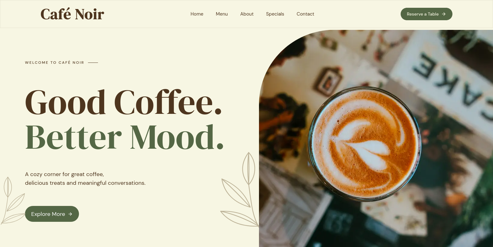

<div align="center">
  <br />
  <a href="https://cafe-noir-template.vercel.app" target="_blank">
    
  </a>
  <br />
  <br />

  # ☕ Café Noir — Artisan Coffee & Bakery Landing Page

  <p align="center">
    <strong>A modern, warm, and interactive coffee shop landing page built with Next.js 16, React 19, Tailwind CSS v4, and Motion.</strong>
  </p>

  <p align="center">
    <a href="https://cafe-noir-template.vercel.app"><strong>View Live Demo »</strong></a>
  </p>

  <div>
    
    
    
    
    
  </div>
</div>

---

## 📋 Table of Contents

- [Overview](#-overview)
- [Key Features](#-key-features)
- [Tech Stack](#-tech-stack)
- [Design System & Palette](#-design-system--palette)
- [Project Structure](#-project-structure)
- [Getting Started](#-getting-started)
  - [Prerequisites](#prerequisites)
  - [Installation](#installation)
  - [Development Server](#development-server)
  - [Production Build](#production-build)
- [Customization](#-customization)
- [Deployment](#-deployment)
- [License](#-license)

---

## ☕ Overview

**Café Noir** is an artisanal coffee house and bakery landing page crafted to deliver an inviting digital experience. Featuring warm earthy tones, fluid interactions, hand-drawn SVG botanical illustrations, and an interactive coffee cup catalogue, it provides the perfect template for cafes, roasteries, bistros, and boutique eateries.

Live Preview: **[cafe-noir-template.vercel.app](https://cafe-noir-template.vercel.app)**

---

## ✨ Key Features

- **☕ Interactive Coffee Catalogue**: Dynamic visualizer that updates beverage liquids, foam layers, and latte art styles (heart, ring, swirl, dot, crema, ice cubes) alongside drink sizes (S / M / L) and tasting notes.
- **🌿 Handcrafted SVG & Botanical Animations**: Custom vector leaf sprigs and self-drawing outline icons (Coffee Bean, Warm Heart, Fresh Leaf) powered by Motion path animation.
- **🎭 Smooth Entrance & Stagger Transitions**: Refined page choreography with scroll-triggered section transitions, backdrop-filter header navigation, and mobile slide-out drawer.
- **⚡ Next.js 16 & React 19 Engine**: Built using the Next.js App Router, Turbopack, Partial Prerendering (PPR), Cache Components, and the React Compiler (`babel-plugin-react-compiler`).
- **🎨 Tailwind CSS v4 Design**: Integrated `@import "tailwindcss"` using theme variables for seamless custom palette styling.
- **♿ Accessible & Motion-Friendly**: Includes `prefers-reduced-motion` support (`useReducedMotion`) across all animated sections.
- **📱 Responsive & Cross-Device Optimized**: Pixel-perfect layout from mobile touch screens to high-resolution desktop viewports.
- **🔍 Comprehensive SEO & Metadata**: Includes OpenGraph cards, Twitter cards, JSON web app manifest, canonical tags, and structured semantic HTML.
- **📬 Contact & Reservation Flow**: Full enquiry form with subject selectors, interactive contact info, opening hours, and direct Google Maps directions.

---

## 🛠️ Tech Stack

| Technology | Purpose |
| :--- | :--- |
| **[Next.js 16](https://nextjs.org/)** | React Framework for SSR, SSG, and App Router architecture |
| **[React 19](https://react.dev/)** | Core UI library with React Compiler support |
| **[Tailwind CSS v4](https://tailwindcss.com/)** | Utility-first CSS framework with native Turbopack loader |
| **[Motion](https://motion.dev/)** | Smooth gesture, entrance, scroll, and SVG path animations |
| **[Lucide React](https://lucide.dev/)** | Crisp, customizable icon set |
| **[Google Fonts](https://fonts.google.com/)** | Typography featuring `DM Sans` & `DM Serif Display` |

---

## 🎨 Design System & Palette

The visual identity of Café Noir centers around an organic, warm palette that reflects specialty roasted coffee and artisanal bakery crafts:

| Color Name | Hex Code | Preview | Usage |
| :--- | :--- | :---: | :--- |
| **Café Noir** | `#4E351E` |  | Primary text, titles, deep accents |
| **Coffee** | `#6C5234` |  | Secondary text, buttons, borders |
| **Old Lace** | `#F7F6E3` |  | Background canvas, light text contrasts |
| **Golden Pastel**| `#F9DC78` |  | Highlights, specials, warm accents |
| **Ebony** | `#546745` |  | Botanical leaf motifs & badges |
| **Grullo** | `#AFA386` |  | Subtle leaf vectors, dividers |
| **Line** | `#E6E1C8` |  | Dividers, subtle borders |
| **Card** | `#FCFBF0` |  | Elevated section card backgrounds |

---

## 📂 Project Structure

```text
cafe-noir/
├── public/
│   ├── about-us/          # Story & about section assets
│   ├── contact/           # Contact visuals & latte graphics
│   ├── hero/              # Hero background & coffee imagery
│   ├── seo/               # Favicon, apple-icon, og-image & manifest
│   ├── special/           # Today's special highlight imagery
│   ├── story/             # Brand story background assets
│   ├── team/              # Team member portraits
│   └── values/            # Values & bakery imagery
├── src/
│   ├── app/
│   │   ├── globals.css    # Tailwind v4 import & CSS custom properties
│   │   ├── layout.js      # Root layout, Google Fonts & SEO metadata
│   │   └── page.js        # Home page combining all sections
│   ├── components/
│   │   ├── blocks/        # Global layout components (Navbar, Footer)
│   │   ├── sections/      # Landing page sections:
│   │   │   ├── hero/      # Hero header with staggered reveal
│   │   │   ├── menu/      # Interactive coffee catalogue cards
│   │   │   ├── story/     # Story section with animated SVG line icons
│   │   │   ├── team/      # Team portraits & role badges
│   │   │   ├── values/    # Brand philosophy & leaf sprigs
│   │   │   ├── specials/  # Today's special drink spotlight
│   │   │   ├── newsletter/# Coffee club email subscription
│   │   │   └── contact/   # Contact details & table reservation form
│   │   ├── svg/           # Reusable botanical leaf SVG components
│   │   └── ui/            # UI atoms (Button, Caption, Title)
│   ├── constants/
│   │   ├── seo/           # Image constants, links & SEO metadata
│   │   └── urls.js        # Base URL configuration
│   └── lib/
│       └── utils.js       # Class merge utilities (clsx & tailwind-merge)
├── next.config.mjs        # Next.js configuration (Turbopack, compiler)
└── package.json           # Project dependencies & scripts
```

---

## 🚀 Getting Started

### Prerequisites

Ensure you have the following installed:
- [Node.js](https://nodejs.org/) (version `18.17` or higher, Node `20+` recommended)
- [npm](https://www.npmjs.com/) (or [pnpm](https://pnpm.io/) / [yarn](https://yarnpkg.com/))
- [Git](https://git-scm.com/)

### Installation

1. **Clone the repository:**
   ```bash
   git clone https://github.com/shashankssangawar/Cafe-Noir-Template.git
   cd Cafe-Noir-Template
   ```

2. **Install dependencies:**
   ```bash
   npm install
   ```

### Development Server

Run the local development server:

```bash
npm run dev
```

Open [http://localhost:3000](http://localhost:3000) in your browser to view the application.

### Production Build

Create an optimized production build:

```bash
npm run build
npm run start
```

To run lint checks:

```bash
npm run lint
```

---

## ⚙️ Customization

- **Site Metadata & SEO**: Update base URLs, titles, and descriptions in `src/app/layout.js` and `src/constants/urls.js`.
- **Menu Items**: Customize drink names, prices, roasting notes, and visual colors in `src/components/sections/menu/catalogue-cards.jsx`.
- **Team Members**: Modify barista bios and portraits in `src/components/sections/team/index.jsx` and `src/constants/seo/image.js`.
- **Contact & Location**: Adjust address, phone, opening hours, and reservation subjects in `src/components/sections/contact/index.jsx`.
- **Brand Colors**: Customize palette values in `src/app/globals.css`.

---

## 🌐 Deployment

The easiest way to deploy this Next.js app is using the [Vercel Platform](https://vercel.com/new):

1. Push your code to a GitHub, GitLab, or Bitbucket repository.
2. Import the project into Vercel.
3. Next.js defaults will automatically detect the build settings (`npm run build`).
4. Click **Deploy**!

---

## 📄 License

This project is licensed under the [MIT License](LICENSE).
